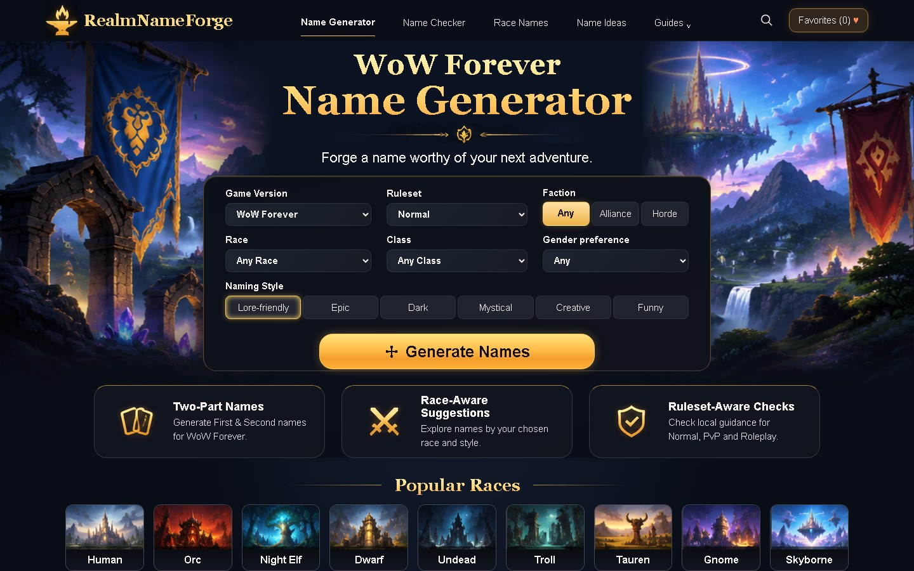

# RealmNameForge

RealmNameForge is an independent, fan-made character naming tool for World of Warcraft: Forever. Generate a two-part name by race and style, keep the part you like while regenerating the other, and save favorites in your browser.

[Open the Name Generator](https://realmnameforge.com/) · [Open the Name Checker](https://realmnameforge.com/wow-forever-name-checker/) · [Browse race names](https://realmnameforge.com/race-name-generator/)

## Recent updates

- Expanded the live name library to 7,097 components across 10 race choices and six styles.
- Added more same-style alternatives when keeping a first or second name.
- Added regional Blizzard Armory searches to the Name Checker. Confirm live availability in the game’s character creator.

See the [contact page](https://realmnameforge.com/contact/) for feedback or support.

RealmNameForge is an independent fan project. World of Warcraft is a trademark of Blizzard Entertainment.
